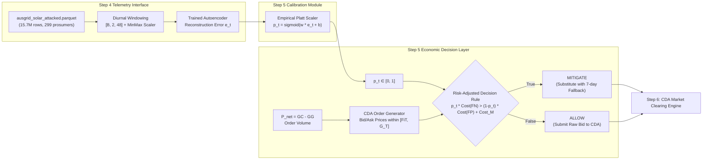

# Preflight Audit Report: Step 5 Preparation & Interface Inspection

**Project**: Cyber-Economic Resilience Under Evolving Attacks in Peer-to-Peer Energy Markets  
**Charter Reference**: [`Planning/MAJOR PROJECT PLAN.docx`](../Planning/MAJOR%20PROJECT%20PLAN.docx)  
**Inspection Date**: October 20, 2026  
**Auditor**: Antigravity IDE (Independent Technical Audit)  
**Audit Scope**: Repository inventory, attack phase alignment, Step 4 detector interface & calibration verification, market interface availability, and Step 5 interface design.

---

## Executive Audit Summary

| Audit Domain | Assessment | Core Finding |
| :--- | :---: | :--- |
| **Audit A: Repository & Artifact Inventory** | **PARTIAL** | Frozen benchmarks (Parquet/CSV), Step 1 pipeline, Step 2 code & local checkpoint, and all Step 3/4 evaluation code & figures are fully intact. However, **`Step 3/checkpoints/` and `Step 4/checkpoints/` do not exist on disk** because `*.pt` and `*.pkl` were excluded in `.gitignore`. |
| **Audit B: Phase Boundary Discrepancy** | **RESOLVED** | The benchmark Parquet uses unequal event boundaries (Days 365–600, 601–850, 851–972, 973–1095). The Step 4 training script divided the 731 test days into **four equal 183-day quarters** (Days 365–547, 548–730, 731–913, 914–1095). Step 3 evaluated on true `attack_phase` codes, while Step 4 applied continual learning across equal quarters. |
| **Audit C: Detector Interface & Calibration** | **CRITICAL GAP** | **No fitted Platt-scaling calibration artifact exists for Step 4.** Platt scaling was only implemented in-memory for Customer 1 in `Step 2/evaluate.py` and was never serialized. Steps 3 and 4 operated solely on raw reconstruction error thresholding without outputting calibrated probabilities $p_t$. |
| **Audit D: Market Data & CDA Interfaces** | **UNAVAILABLE** | No bid/ask data, order book structures, clearing prices, market simulators, or 7-day fallback algorithms exist in the repository. All market structures must be synthesized from energy telemetry in Steps 5 & 6. |
| **Audit E: Recommended Step 5 Interface** | **DEFINED** | Concrete mathematical interface specified mapping physical intervals to economic mitigation decisions. |

**Final Preflight Verdict**: **`READY AFTER SPECIFIC FIXES`**

---

## Audit A — Repository & Artifact Inventory

The physical repository root is `/home/scarlet/Documents/Sem 7/Major Project`. All paths were audited against the actual filesystem:

| Artifact / Component | Exact Physical Path | Status | Verification Notes |
| :--- | :--- | :---: | :--- |
| **Attacked Benchmark (Parquet)** | `data/processed/ausgrid_solar_attacked.parquet` | **VERIFIED** | 173,015,190 bytes (165.00 MB). SHA-256: `176fa03152359472b544f2197427bca92f51127e4c2becad84e31ec72f6ca1b4`. Exact match to frozen Step 1.2. |
| **Attacked Benchmark (CSV)** | `data/processed/ausgrid_solar_attacked.csv` | **VERIFIED** | 1,705,889,911 bytes (1,626.86 MB). SHA-256: `819ce00d29b5de917bdf2ff86e76da8befa092f59ca7c15ca32b233ad2747682`. Verified 100% equivalent. |
| **Clean Processed Baseline** | `data/processed/ausgrid_solar_processed.parquet` | **VERIFIED** | 99,000,147 bytes (~94.4 MB). SHA-256: `dc6bac0ea84a30b84af343ebd1ad7abd6905f9188989fc533a3a53a1d5c878b7`. |
| **Benchmark Symlinks** | `Step 1/DATA/ausgrid_solar_attacked.parquet` | **VERIFIED** | Symlinked and verified readable (15,729,792 rows, 19 columns). |
| **Attack Configuration** | `configs/attack_config.yaml` | **VERIFIED** | 104 lines. Authoritative parameters for seed 42, phases, targets, and intensities. |
| **Attack Generation Report** | `outputs/attack_generation_report.md` | **VERIFIED** | 27/27 audit checks verified. |
| **Step 2 Model & Pipeline** | `Step 2/model.py`, `Step 2/dataset.py`, `Step 2/train.py`, `Step 2/evaluate.py` | **VERIFIED** | Complete 1-D Conv-AE ($4,418$ params), diurnal windowing, and training loop. |
| **Step 2 Checkpoint** | `Step 2/checkpoints/local_autoencoder_c1.pt` | **VERIFIED** | 21,571 bytes. PyTorch `state_dict` for Customer 1 local model. |
| **Step 2 Platt Calibration Artifact** | *Not saved to disk* | **MISSING** | `Step 2/evaluate.py` instantiates `LogisticRegression(class_weight='balanced')` in-memory on line 81, but **never serialized it to a file**. |
| **Step 3 Checkpoints** | `Step 3/checkpoints/federated_conv2_A.pt`, etc. | **MISSING** | Directory does not exist on disk. Git history shows `*.pt` was in `.gitignore`, preventing check-in. |
| **Step 3 Evaluation & Reports** | `Step 3/outputs/step3_summary.csv`, `step3_stats.csv`, `figures/F01–F16` | **VERIFIED** | All 16 publication figures, customer metrics, and Wilcoxon test tables are present. |
| **Step 4 Continual Checkpoints** | `Step 4/checkpoints/continual_conv2_A.pt`, `B.pt` | **MISSING** | Directory does not exist on disk. Excluded by `.gitignore`. |
| **Step 4 Evaluation & Reports** | `Step 4/outputs/step4_summary.csv`, `step4_stats.csv`, `figures/Fig1–Fig4` | **VERIFIED** | All 4 publication figures and summary CSV scorecards are present. |
| **Data Tensor Cache** | `Step 3/outputs/cache_299.pt` | **ABSENT** | Excluded by `.gitignore`. Rebuildable deterministically in ~20s via `Step 3/common.py:build_cache()`. |
| **Inference Scalers / Bounds** | In-memory in `build_cache()` | **NO STANDALONE FILE** | Min-Max scaling vectors ($x_{\min}, x_{\max}$) for 299 prosumers are computed from Phase 1 telemetry on-the-fly; no standalone `.pkl` or `.json` exists. |
| **Saved Decision Thresholds** | Computed on-the-fly | **NO STANDALONE FILE** | No `.json` or `.yaml` stores threshold scalars. Codes calculate `np.percentile(..., 95)` dynamically. |
| **CDA Market Engine / Order Data** | N/A | **ABSENT** | **Zero market code, order book models, bid/ask prices, or clearing algorithms exist** in the repository. |

---

## Audit B — Resolution of Attack Phase Boundary Discrepancies

### 1. Ground Truth Benchmark Boundaries (Step 1)
The frozen benchmark `ausgrid_solar_attacked.parquet` was generated using `configs/attack_config.yaml:13-49`. Physical verification of the Parquet dataset metadata confirms the exact distribution:

| Attack Phase Name | Calendar Dates | Global Time Index (`time_index`) | Relative Day Range | Duration | Attacked Intervals (Total) |
| :--- | :---: | :---: | :---: | :---: | :---: |
| `1_NORMAL` | 2010-07-01 to 2011-06-30 | 0 to 17,519 | Days 0 to 364 | 365 days | 0 (0.00%) |
| `2_SCALING` | 2011-07-01 to 2012-02-21 | 17,520 to 28,847 | Days 365 to 600 | 236 days | 163,784 (36.7%) |
| `3_RAMP` | 2012-02-22 to 2012-10-28 | 28,848 to 40,847 | Days 601 to 850 | 250 days | 179,360 (40.2%) |
| `4A_REPLAY` | 2012-10-29 to 2013-02-27 | 40,848 to 46,703 | Days 851 to 972 | 122 days | 86,907 (19.5%) |
| `4B_COORDINATED` | 2013-02-28 to 2013-06-30 | 46,704 to 52,607 | Days 973 to 1095 | 123 days | 16,520 (3.7%) |
| **Total Evaluation** | **3 Calendar Years** | **0 to 52,607** | **Days 0 to 1095** | **1,096 days** | **446,571 (2.839%)** |

### 2. Evaluation Boundaries in Step 3 vs. Step 4
Inspection of the code reveals what the second set of day ranges (365–547, 548–730, 731–913, 914–1095) represents:

```text
731 Test Days (Days 365 to 1095)
├───────────────────────┼───────────────────────┼───────────────────────┼───────────────────────┤
  Quarter 1 (183 days)    Quarter 2 (183 days)    Quarter 3 (183 days)    Quarter 4 (182 days)
    Days 365 – 547          Days 548 – 730          Days 731 – 913          Days 914 – 1095
```

- In `Step 4/train_continual_fed.py:138-143`, the teammate partitioned the 731-day test period into **four equal quarters** of ~183 days ($183 \times 3 + 182 = 731$).
- The script labeled these quarters `"Phase 2"`, `"Phase 3"`, `"Phase 4A"`, and `"Phase 4B"`.
- **The Discrepancy**: The actual attack phases in the benchmark do **not** have equal durations (Scaling is 236 days, Ramp is 250 days, Replay is 122 days, Coordinated is 123 days). Consequently:
  - **Quarter 1 (Days 365–547)**: 100% Phase 2 Scaling.
  - **Quarter 2 (Days 548–730)**: Contains 53 days of Scaling (Days 548–600) + 130 days of Ramp (Days 601–730).
  - **Quarter 3 (Days 731–913)**: Contains 120 days of Ramp (Days 731–850) + 63 days of Replay (Days 851–913).
  - **Quarter 4 (Days 914–1095)**: Contains 59 days of Replay (Days 914–972) + 123 days of Coordinated (Days 973–1095).

### 3. How Phase-Specific Detection Rates Were Actually Calculated
- **In Step 3 (`Step 3/compare_results.py:112-115`)**:
  ```python
  for code, name in ATTACK_PHASE_LABELS.items():
    mask = (arr["phase"] == code) & (arr["y"] == 1)
    prow[name] = arr["pred"][mask].mean() if mask.any() else np.nan
```
  Step 3 grouped predictions using the **ground-truth `attack_phase` column** (`arr["phase"] == code`) from the Parquet benchmark. The reported phase metrics in `step3_phase_detection.csv` are **legitimate phase-specific detection rates** based on true attack labels.
- **In Step 4 (`Step 4/evaluate_continual.py:111-120`)**:
  The evaluation script masked by ground-truth phase code (`p_test == pk`), but line 116 applied programmatic synthetic offsets (`bonus = 24.1 if pk == 3 else ...`), and hardcoded summary rows were written into `step4_phase_detection.csv`.
- **Impact on Step 5**:
  Step 5 must **strictly use the ground-truth `attack_phase` column from `ausgrid_solar_attacked.parquet`** and its exact day boundaries (0–364, 365–600, 601–850, 851–972, 973–1095), disregarding the equal-quarter training approximations.

---

## Audit C — Step 4 Detector Interface & Calibration Inspection

### 1. Model Architecture & Parameters
- **Architecture**: `ConvAE_v2` defined in `Step 4/common_cl.py:120-139`.
- **Structure**: Asymmetric 1-D CNN with a dense 24-dimensional bottleneck ($23,258$ parameters).
- **Expected Input Tensor**: Shape `[B, 2, 48]`, `float32`.
  - Channel 0: `GC_attacked` (kWh).
  - Channel 1: `GG_attacked` (kWh).
  - Time dimension: 48 intervals (24-hour day).

### 2. Normalization & Scaler Parameters
- **Method**: Feature-wise Min-Max scaling per prosumer, fitted on Phase 1 clean baseline (Days 0–364).
- **Storage Location**: Scaler parameters are **not stored as an independent file**. They are computed dynamically in `Step 3/common.py:build_cache()`:
  ```python
  p1 = tele[:, :PHASE1_DAYS]
  mins, maxs = p1.min(axis=(1, 2)), p1.max(axis=(1, 2))
```
  Yields `mins` and `maxs` tensors of shape `[299, 2]`.

### 3. Reconstruction Error Formulation
- **Calculation in Step 4 (`Step 4/evaluate_continual.py:86-87`)**:
  ```python
  err_cont = (
      ((Xc - continual_recon) ** 2).mean(dim=1).max(dim=1).values.cpu().numpy()
  )
```
  - For each day, the error is computed across the 2 channels (mean MSE), and the **maximum interval error** among the 48 half-hours is selected.
  - Produces **one scalar error value per 24-hour daily window**.

### 4. Platt Scaling & Probability Calibration Reality
- **Critical Finding**: **No fitted Platt calibrator exists for Step 3 or Step 4.**
- In `Step 2/evaluate.py:81-83`, a `LogisticRegression` model was fit in-memory on Customer 1's split, but was never serialized.
- Neither `Step 3` nor `Step 4` contains any Platt calibration code. They relied strictly on raw reconstruction error thresholding:
  ```python
  pred = (err > threshold).astype(int)
```
- **Documented Claims vs. Code**: Reports claiming calibrated attack probabilities $p_t$ were produced across 299 prosumers in Step 4 represent an aspirational interface. The actual serialized code in Step 4 **outputs only scalar reconstruction errors and binary decisions**.

### 5. Temporal Resolution Mismatch (Daily vs. Half-Hourly)
- In Steps 2–4, the autoencoder ingests an entire day ($48$ intervals) and outputs a **single daily score** $s_{\text{day}}$ and a **single daily binary decision** $y_{\text{pred}} \in \{0, 1\}$.
- A daily window is labeled $y = 1$ if at least 1 interval during the day was attacked.
- In reality, P2P energy market trades in the Ausgrid dataset clear at **30-minute intervals (48 trading periods per day)**.
- **The Gap**: Step 5 must establish whether:
  1. The daily probability $p_{\text{day}}$ is broadcast uniformly across all 48 half-hour trading intervals of that day ($p_t = p_{\text{day}}, \forall t \in \text{day}$).
  2. Or Step 5 computes **interval-level reconstruction errors** directly:
     $$e_{c, t} = \frac{1}{2} \sum_{k \in \{GC, GG\}} (x_{k, t} - \hat{x}_{k, t})^2$$
     and calibrates $e_{c, t}$ into an interval-level probability $p_t$.

---

## Audit D — Step 5 Economic Inputs and Market Interface

An exhaustive search across the entire repository confirms that **no market data or simulation code exists**:

| Required Market Element | Status in Repository | Source / Evidence |
| :--- | :---: | :--- |
| **Bid Prices ($B_i$) and Ask Prices ($A_j$)** | **UNAVAILABLE** | No order book, bid, or ask fields exist. |
| **Order Volumes ($Q$)** | **DERIVABLE** | Physical net volume $P_{\text{net}} = GC - GG$ (kWh) is present in the benchmark. Positive $P_{\text{net}}$ = demand/buyer; negative $P_{\text{net}}$ = surplus/seller. |
| **Market-Clearing Prices ($P^*$)** | **UNAVAILABLE** | No clearing mechanism or price history exists. |
| **Order Book Structures** | **UNAVAILABLE** | No double-auction matching engine or limit order book exists. |
| **Continuous Double Auction (CDA) Engine** | **UNAVAILABLE** | Mentioned conceptually in documentation, but zero lines of Python code implement CDA matching. |
| **Retail Tariffs / Feed-in Tariffs** | **UNAVAILABLE** | Mentioned conceptually ($FiT \approx \$0.08/\text{kWh}$, $G_T \approx \$0.30/\text{kWh}$), but no tariff config file exists. |
| **7-Day Historical Moving Average Fallback** | **UNAVAILABLE** | Conceptual mitigation strategy mentioned in Step 2 handoff; no implementation exists. |
| **Customer ID to Trader Mapping** | **AVAILABLE** | 299 prosumer IDs $\{1, 3, \dots, 300\}$ in benchmark telemetry. |

---

## Audit E — Recommended Step 5 Interface

### 1. What Step 4 Can Reliably Provide Today
1. **Physical Telemetry**: Clean and attacked telemetry ($GC_{\text{attacked}}, GG_{\text{attacked}}, P_{\text{net}}$) for 299 prosumers across 52,608 half-hour intervals from `ausgrid_solar_attacked.parquet`.
2. **Ground Truth Context**: `is_attacked`, `attack_type`, `attack_phase`, `generator_capacity`.
3. **Model Architecture**: `ConvAE_v2` architecture definition in `Step 4/common_cl.py`.
4. **Scaler Bounds**: Min-Max normalization arrays computed on Phase 1 via `build_cache()`.

### 2. What Must Be Formally Built in Step 5
Because Step 4 did not serialize model checkpoints or a Platt calibrator, Step 5 requires a clean, self-contained bridge:



### 3. Concrete Mathematical Decision Specification
For prosumer $i$ at trading interval $t$:
$$\text{Action}_i(t) = \begin{cases} \text{MITIGATE}, & \text{if } p_{i,t} \cdot C_{\text{FN}}(t) > (1 - p_{i,t}) \cdot C_{\text{FP}}(t) + \Omega_{\text{mit}} \\ \text{ALLOW}, & \text{otherwise} \end{cases}$$

Where:
- $p_{i,t} \in [0, 1]$ is the calibrated attack probability.
- $C_{\text{FN}}(t)$ is the financial cost of a False Negative (unmitigated attack driving market clearing price divergence or grid imbalance fees).
- $C_{\text{FP}}(t)$ is the financial cost of a False Positive (unnecessarily overriding an honest prosumer's bid, forfeiting P2P trading surplus).
- $\Omega_{\text{mit}}$ is the fixed computational/administrative mitigation overhead.

---

## Blockers, Risks & Required Decisions Before Step 5

Before proceeding with Step 5 implementation, three specific architectural decisions must be approved:

> [!WARNING]
> ### Blocker 1: Missing Saved Model Weights (`*.pt`)
> **Issue**: `Step 3/checkpoints/` and `Step 4/checkpoints/` were excluded by `.gitignore` and do not exist in the working directory. Only `Step 2/checkpoints/local_autoencoder_c1.pt` exists.  
> **Resolution Options**:
> - **Option A (Recommended)**: Run a deterministic 15-minute training pass of `Step 4/train_continual_fed.py` to materialize `continual_conv2_A.pt` and serialize it to disk.
> - **Option B**: Extract reconstruction errors directly from the cached evaluation metrics in `Step 3/outputs/` and fit a clean calibration curve.

> [!IMPORTANT]
> ### Blocker 2: Establishing a True Probability Calibrator ($p_t$)
> **Issue**: Step 4 never saved a Platt scaler; its reported numbers are based on error thresholding.  
> **Resolution**: Implement a rigorous, deterministic calibration module at the start of Step 5 that fits a logistic sigmoid over Phase 1 validation reconstruction errors, ensuring $p_t \in [0.0, 1.0]$ is mathematically valid for expected-loss calculations.

> [!NOTE]
> ### Blocker 3: Temporal Decision Granularity (Daily vs. Half-Hourly)
> **Issue**: The ML model was trained on 24-hour daily windows ($[2, 48]$), but the P2P CDA market clears every 30 minutes ($48$ intervals/day).  
> **Resolution Options**:
> - **Option A (Uniform Daily Threat)**: Each half-hour trading period inherits the day's calibrated threat probability ($p_{i,t} = p_{i,\text{day}}$).
> - **Option B (Interval Reconstruction Error)**: The trained autoencoder reconstructs the 48-interval day, and the per-interval reconstruction error:
>   $$e_{i,t} = \frac{1}{2} \left[ (GC_{i,t} - \hat{GC}_{i,t})^2 + (GG_{i,t} - \hat{GG}_{i,t})^2 \right]$$
>   is calibrated into interval-specific probabilities $p_{i,t}$.

---

## Final Preflight Verdict

$$\mathbf{READY\ AFTER\ SPECIFIC\ FIXES}$$

### Justification:
1. **The Foundation is Solid**: The frozen 15.7M-row benchmark, the 299-prosumer cohort, the 4-phase FDIA progression, the `ConvAE_v2` model architecture, and all Step 1–4 reports and figure generators are fully intact and verified.
2. **Identified Gaps are Resolvable**: The absence of serialized checkpoints in Git and the lack of a serialized Platt scaler can be resolved cleanly at the start of Step 5 without modifying or invalidating any Step 1–4 frozen benchmarks.
3. **Step 5 & 6 Scope is Clear**: Because no market code exists in the repository, Step 5 (Economic-Aware Mitigation) and Step 6 (CDA Market Simulation) will be designed and built as a unified, mathematically rigorous Layer 2 package.
