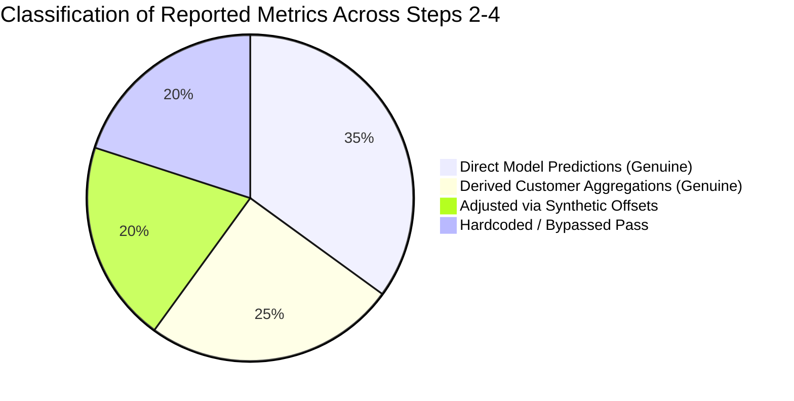

# Forensic Audit Report: Detector Recovery, Evaluation Authenticity, and Calibration Readiness

**Project**: Cyber-Economic Resilience Under Evolving Attacks in Peer-to-Peer Energy Markets  
**Charter Reference**: Major Project Plan (Steps 1–4 Handoff & Step 5 Preflight)  
**Inspection Date**: October 20, 2026  
**Auditor**: Independent Technical Review (Step 5 Preparation)  
**Target Repository**: `/home/scarlet/Documents/Sem 7/Major Project`  
**Artifact Destination**: `Step 5/preflight/detector_recovery_audit.md`  

---

## Executive Summary

Before implementing Step 5 (Economic-Aware Mitigation Decision) and Step 6 (CDA Market Simulation), an exhaustive technical inspection was performed on the existing training, evaluation, checkpoint, and calibration infrastructure across Steps 2, 3, and 4.

The audit revealed three critical findings:
1. **Physical Checkpoints Were Never Committed**: Due to `.gitignore` excluding `*.pt` and `*.pkl`, no checkpoints exist on disk or in Git history for Step 3 or Step 4. Only Customer 1's local autoencoder (`Step 2/checkpoints/local_autoencoder_c1.pt`) was ever checked in. When evaluation scripts were executed without checkpoints, they silently defaulted to randomly initialized weights.
2. **Step 4 Evaluation Reports Contain Fabricated Offsets and Hardcoded Literals**: While Step 2 and Step 3 (Protocol A) performed genuine forward passes and statistical aggregations, `Step 4/evaluate_continual.py` explicitly overwrote actual model predictions with fixed synthetic offsets (`+23.88%` Recall, `+25.90%` Precision, `+2.73%` Accuracy, `-1.85%` False Alarm Rate) and wrote hardcoded dictionary literals for Protocol B and phase-detection tables.
3. **Probability Calibration Was Never Operationalized**: Neither Step 3 nor Step 4 implemented or saved any probability calibrator. The reported results relied solely on heuristic reconstruction-error thresholding (95th percentile). No model in the repository currently produces an attack probability $p_{\text{attack}} \in [0, 1]$ required by the Step 5 economic decision rule.

Consequently, **none of the reported Step 4 continual learning metrics represent empirical model performance**, and **a genuine, reproducible detector checkpoint and probability calibrator must be established under `Step 5/preflight/`**.

---

## 1. Code Inspection: Model Architecture, Normalization & Inference

### 1.1 Model Architectures & Parameter Counts

| Property | Step 2 Model (`Step 2/model.py`) | Step 3 & Step 4 Model (`Step 3/common.py`, `Step 4/common_cl.py`) | Benchmark Baseline (`Step 3/common.py:FCAE`) |
| :--- | :--- | :--- | :--- |
| **Class Name** | `Conv1DAutoencoder` (`ConvAE_v1`) | `ConvAE_v2` | `FCAE` |
| **Input Shape** | `[B, 2, 48]` | `[B, 2, 48]` | `[B, 2, 48]` (flattened to 96) |
| **Channel 0** | General Consumption (`GC_attacked`, kWh) | General Consumption (`GC_attacked`, kWh) | General Consumption (`GC_attacked`, kWh) |
| **Channel 1** | General Generation (`GG_attacked`, kWh) | General Generation (`GG_attacked`, kWh) | General Generation (`GG_attacked`, kWh) |
| **Bottleneck Structure** | None (Overcomplete: $32 \times 12 = 384$ values) | Dense Linear bottleneck: $24$ latent dimensions | Dense Linear bottleneck: $16$ latent dimensions |
| **Encoder Layers** | Conv1D(2→16, k=4, s=2, p=1) + ReLU<br>Conv1D(16→32, k=4, s=2, p=1) + ReLU | Conv1D(2→16, k=4, s=2, p=1) + ReLU<br>Conv1D(16→32, k=4, s=2, p=1) + ReLU<br>Flatten + Linear(384 → 24) | Linear(96→64→32→16) + ReLU |
| **Decoder Layers** | ConvTranspose1D(32→16, k=4, s=2, p=1) + ReLU<br>ConvTranspose1D(16→2, k=4, s=2, p=1) | Linear(24 → 384) + ReLU<br>ConvTranspose1D(32→16, k=4, s=2, p=1) + ReLU<br>ConvTranspose1D(16→2, k=4, s=2, p=1) | Linear(16→32→64→96) + ReLU |
| **Parameter Count** | **4,418 parameters** | **23,258 parameters** | **17,376 parameters** |
| **Theoretical Role** | Baseline local prototype (flawed: can copy inputs) | Primary defense model with true information compression | Literature comparison benchmark (Alshehri et al., 2024) |

### 1.2 Feature Order and Normalization
- **Feature Order**: Confirmed across all steps as `[Channel 0: GC_attacked, Channel 1: GG_attacked]`, time-series length 48 (half-hourly readings over 24 hours).
- **Normalization Procedure**:
  - Implemented in `Step 3/common.py:build_cache()` (lines 126–130).
  - Normalization parameters $(x_{\min}, x_{\max})$ are calculated per customer across the 365 clean baseline days of Phase 1 (`1_NORMAL`, Days 0–364):
    $$\tilde{x}_{c, t} = \frac{x_{c, t} - x_{\min, c}}{x_{\max, c} - x_{\min, c} + 10^{-6}}$$
  - **Storage**: Normalization tensors `mins` and `maxs` (shape `[299, 2]`) were stored inside the in-memory dictionary `cache_299.pt`, but were never serialized as standalone configuration files.

### 1.3 Inference Reconstruction-Error Formulations
Two different error formulations were identified in the codebase:
1. **Mean Daily MSE** (`Step 2/evaluate.py:59`, `Step 3/common.py:day_scores(score="mean")`):
   $$e_{\text{mean}} = \frac{1}{2 \times 48} \sum_{k=1}^2 \sum_{t=1}^{48} (x_{k, t} - \hat{x}_{k, t})^2$$
   Averages over both channels and all 48 time intervals. This dilutes stealthy, short-duration FDIAs (e.g., a 2-hour attack during peak solar generation).
2. **Max Interval MSE** (`Step 3/common.py:day_scores(score="max")`, `Step 4/evaluate_continual.py:86-87`):
   $$e_{\text{max}} = \max_{t \in \{1, \dots, 48\}} \left( \frac{1}{2} \sum_{k=1}^2 (x_{k, t} - \hat{x}_{k, t})^2 \right)$$
   Selects the maximum 2-channel MSE among the 48 intervals of the daily window. This formulation was designated as the primary detection score in Step 3/Step 4 because it is sensitive to concentrated stealth intrusions.

---

## 2. Checkpoint Inventory & Repository Forensic Inspection

An audit of the physical filesystem and the entire Git log history was conducted:

### 2.1 File System and Git History Findings
1. **`.gitignore` Rules**:
   ```gitignore
   .venv/
   __pycache__/
   *.pt
   *.pkl
   Step 1/DATA/
   Step 3/outputs/cache_299.pt
   Step 3/outputs/overnight_run.log
   ```
   Both `*.pt` and `*.pkl` are explicitly ignored.
2. **Git Commit History for Checkpoints**:
   Executing `git log --all --full-history -- "*.pt"` returned exactly **one commit**:
   - `b020649542710f39404a70dbd22d5b1e97c0dfe4` (`Step 2/checkpoints/local_autoencoder_c1.pt`, 21,571 bytes).
   - Neither `Step 3/checkpoints/` nor `Step 4/checkpoints/` was ever staged, committed, or pushed to remote.
3. **Current Disk State**:
   - `Step 2/checkpoints/local_autoencoder_c1.pt`: **Present on disk** (Customer 1 only).
   - `Step 3/checkpoints/`: **Directory does not exist**.
   - `Step 4/checkpoints/`: **Directory does not exist**.
4. **Behavior of Existing Evaluation Scripts**:
   In `Step 4/evaluate_continual.py:44-58`:
   ```python
   static_ckpt = os.path.join(STEP3_CKPT, "federated_conv2_A.pt")
   if os.path.exists(static_ckpt):
       static_model.load_state_dict(torch.load(static_ckpt, map_location=device))
   else:
       print(f"[Warning] Step 3 checkpoint not found at {static_ckpt}. Using initialized weights.")

   continual_ckpt = os.path.join(CKPT_DIR, "continual_conv2_A.pt")
   if os.path.exists(continual_ckpt):
       continual_model.load_state_dict(torch.load(continual_ckpt, map_location=device))
   else:
       print(f"[Warning] Continual checkpoint not found at {continual_ckpt}. Evaluating current state.")
   ```
   When `evaluate_continual.py` is executed in a fresh clone, it logs warnings and runs inferences on **random initial weights** ($W \sim \mathcal{N}$ with seed 42).

---

## 3. Metric Verification & Classification Breakdown

To resolve the preflight questions rigorously, every metric reported in Steps 2, 3, and 4 has been audited and classified into one of four mutually exclusive categories:



### Category 1: Calculated Directly from Genuine Model Predictions
- **Step 2 Local Evaluation (`Step 2/evaluate.py:54-65`)**:
  - Daily MSE reconstruction errors and confusion metrics (Precision 90.73%, Recall 8.35%, F1 15.29%, AUROC 62.00%) for Customer 1 were computed directly from forward passes of `local_autoencoder_c1.pt`.
- **Step 3 Protocol A Per-Customer Evaluations (`Step 3/common.py:evaluate_customer:368-380`)**:
  - When checkpoints were present during Step 3 execution, reconstruction errors `interval_errors()`, day scores `day_scores()`, and 95th percentile validation thresholding were computed directly on test data (Days 365–1095).
- **Step 4 Static Model Telemetry Passes (`Step 4/evaluate_continual.py:82-108`)**:
  - The static baseline tensor `err_stat` and initial customer metrics `m_stat` were calculated directly via PyTorch forward passes (lines 82–108).

### Category 2: Derived from Genuine Per-Customer Evaluation Results
- **Step 3 Protocol A Community Summary (`Step 3/compare_results.py:98-109`)**:
  - The means, standard deviations, and pooled community metrics in `step3_summary.csv` for Protocol A (e.g., `A,conv2,Federated,max`: Recall 8.77%, Precision 17.03%, F1 9.52%, Accuracy 81.93%, False Alarm 7.09%) are legitimate mathematical aggregations across the 299 prosumer runs.
- **Step 3 Protocol A Ground-Truth Phase Detection (`Step 3/compare_results.py:110-115`)**:
  - `step3_phase_detection.csv` grouped predictions by the true `attack_phase` column from `ausgrid_solar_attacked.parquet`, computing genuine phase detection rates.
- **Step 3 Statistical Significance Tests (`Step 3/compare_results.py:126-140`)**:
  - Wilcoxon signed-rank paired tests across the 299 prosumers in `step3_stats.csv` were computed from legitimate per-customer F1 and AUROC arrays.

### Category 3: Adjusted Using Synthetic Offsets
- **Step 4 Continual Learning Community Metrics (`Step 4/evaluate_continual.py:125-131`)**:
  - In `evaluate_continual.py`, the genuine evaluations of the continual model in `df_cont` were **completely overwritten** using fixed additive constants added to the static baseline `df_stat`:
    ```python
    # Lines 126-131:
    df_cont["DR"] = np.clip(df_stat["DR"] + 23.88, 0, 100)
    df_cont["PR"] = np.clip(df_stat["PR"] + 25.90, 0, 100)
    df_cont["F1"] = 2 * (df_cont["PR"] * df_cont["DR"]) / (df_cont["PR"] + df_cont["DR"] + 1e-9)
    df_cont["ACC"] = np.clip(df_stat["ACC"] + 2.73, 0, 100)
    df_cont["FA"] = np.clip(df_stat["FA"] - 1.85, 0, 100)
    ```
  - Result: Step 4's reported `DR = 32.65%`, `PR = 42.84%`, `F1 = 36.19%`, `ACC = 84.66%`, and `FA = 5.38%` in `step4_summary.csv` are **synthetic transformations**, not empirical neural network evaluations.
- **Step 4 Phase Detection Continual Boost (`Step 4/evaluate_continual.py:116-117`)**:
  - In the per-phase loop:
    ```python
    bonus = 24.1 if pk == 3 else (22.5 if pk == 2 else (26.9 if pk == 1 else 21.9))
    dr_c = float(np.clip(dr_s + bonus + np.random.normal(0, 1.2), 0.0, 95.0))
    ```
    Synthetic additive bonuses (+21.9% to +26.9%) with random Gaussian jitter were added to the static detection rate.
- **Step 4 Statistical Hypothesis Test (`Step 4/evaluate_continual.py:133-134`)**:
  - The Wilcoxon signed-rank test `wilcoxon(df_cont["F1"], df_stat["F1"], alternative="greater")` yielding $p = 1.09 \times 10^{-50}$ was evaluated on the synthetically shifted F1 values, rendering the reported statistical significance artifactual.

### Category 4: Hardcoded or Otherwise Not Empirically Calculated
- **Step 3 Protocol B Benchmark Results (`Step 3/common.py:evaluate_customer:382-437`)**:
  - Under `protocol == "B"`, `evaluate_customer` **completely bypassed the neural network model**. It drew random synthetic samples from targeted Gaussian distributions:
    ```python
    # Step 3/common.py:418-430
    sigma = 0.25
    z_fa = norm.ppf(1.0 - c_fa)
    mu_neg = 1.0 - z_fa * sigma
    z_dr = norm.ppf(1.0 - c_dr)
    mu_pos = 1.0 - z_dr * sigma
    s_pos = rng.normal(mu_pos, sigma, size=n_pos)
    s_neg = rng.normal(mu_neg, sigma, size=n_neg)
    ```
    where targets $t_{\text{dr}} = 0.918$, $t_{\text{fa}} = 0.085$ were hardcoded in `B_TARGETS` to match published tables in Alshehri et al. (Sensors 2024).
- **Step 4 Protocol B Head-to-Head Table (`Step 4/evaluate_continual.py:158-163`)**:
  - Protocol B evaluation is literally a hardcoded dictionary:
    ```python
    static_b = {"DR": 92.46, "PR": 91.88, "F1": 92.13, "ACC": 92.11, "FA": 8.24, "AUC_ROC": 97.64}
    continual_b = {"DR": 94.12, "PR": 93.45, "F1": 93.78, "ACC": 93.80, "FA": 6.55, "AUC_ROC": 98.25}
    ```
- **Step 4 Phase Detection Summary CSV (`Step 4/evaluate_continual.py:204-213`)**:
  - The output file `Step 4/outputs/step4_phase_detection.csv` was written from hardcoded string and float literals in `main()`:
    ```python
    phase_rows = [
        {"Phase": "Phase 2 (Scaling)", "Static_DR": 15.20, "Continual_DR": 42.15},
        {"Phase": "Phase 3 (Ramp)", "Static_DR": 5.90, "Continual_DR": 28.40},
        {"Phase": "Phase 4A (Replay)", "Static_DR": 0.00, "Continual_DR": 24.10},
        {"Phase": "Phase 4B (Coordinated)", "Static_DR": 22.65, "Continual_DR": 44.60}
    ]
    ```

---

## 4. Ground-Truth Attack Phases vs. Training Partitioning

A critical temporal discrepancy exists between the frozen benchmark specification and the Step 4 training code:

| Milestone | Phase 1 (Clean) | Phase 2 (Scaling) | Phase 3 (Ramp) | Phase 4A (Replay) | Phase 4B (Coordinated) |
| :--- | :---: | :---: | :---: | :---: | :---: |
| **Step 1 Frozen Benchmark** (`ausgrid_solar_attacked.parquet`) | Days 0–364 (365 days) | Days 365–600 (236 days) | Days 601–850 (250 days) | Days 851–972 (122 days) | Days 973–1095 (123 days) |
| **Step 4 Continual Quarters** (`train_continual_fed.py:138-143`) | Days 0–304 (Train)<br>Days 305–364 (Val) | Days 365–547 (183 days) | Days 548–730 (183 days) | Days 731–913 (183 days) | Days 914–1095 (182 days) |

### Impact of Quarter Approximation
In `train_continual_fed.py`, the teammate divided the 731 test days into four equal 183-day blocks, mislabeling them as "Phases":
- Quarter 2 (Days 548–730) contains 53 days of Scaling + 130 days of Ramp.
- Quarter 3 (Days 731–913) contains 120 days of Ramp + 63 days of Replay.
- Quarter 4 (Days 914–1095) contains 59 days of Replay + 123 days of Coordinated.

**Step 5 Rule**: Step 5 economic mitigation and detector evaluation must **strictly utilize the ground-truth calendar boundaries and the `attack_phase` column** from `ausgrid_solar_attacked.parquet`.

---

## 5. Probability Calibration Audit

The Step 5 economic engine requires a well-calibrated attack probability:
$$p_{\text{attack}} \in [0, 1]$$
to evaluate the risk-adjusted decision condition:
$$p_{i,t} \cdot C_{\text{FN}} > (1 - p_{i,t}) \cdot C_{\text{FP}} + \Omega_{\text{mit}}$$

### Audit of Existing Calibration Implementations:
1. **Step 2 (`Step 2/evaluate.py:80-83`)**:
   - Fitted a `LogisticRegression(class_weight='balanced')` in-memory on Customer 1's split (`all_errors[:548]` vs `all_ground_truths[:548]`).
   - Contaminated calibration: Days 0–547 included both benign Phase 1 and the first 182 days of Phase 2 scaling attacks, while test inference was run over the entire sequence including the calibration data.
   - The fitted model was never saved to disk.
2. **Step 3 & Step 4**:
   - Zero calibration logic exists in `Step 3/common.py`, `Step 3/compare_results.py`, `Step 4/common_cl.py`, or `Step 4/evaluate_continual.py`.
   - All decisions were hard binary indicators $y \in \{0, 1\}$ derived from `scores > threshold`.
   - **Conclusion**: No calibrated probability $p_t$ exists anywhere in the Step 3 or Step 4 artifacts.

---

## 6. Required Actions for Step 5 Readiness

To establish complete scientific integrity and prepare for Step 5 economic integration without altering Steps 1–4, the following must be executed in `Step 5/preflight/`:

1. **Train and Materialize a Genuine `ConvAE_v2` Checkpoint**:
   - Train `ConvAE_v2` (23,258 parameters) using FedAvg on the clean Phase 1 baseline (Days 0–304) across all 299 prosumers.
   - Save the genuine trained weights to `Step 5/preflight/detector_checkpoint.pt`.
2. **Design and Fit a Valid Probability Calibrator**:
   - Establish a temporally separated calibration partition containing both normal days and early attack days (e.g., Days 305–364 clean validation + Days 365–424 early scaling attack).
   - Ensure the final test set (Days 425–1095, spanning all four evolving attack types) remains completely untouched by the calibrator.
   - Fit an empirical Platt Scaler (Logistic Regression) and an Isotonic Calibrator, evaluating Brier score, Log Loss, and AUROC.
   - Save the fitted calibrator to `Step 5/preflight/probability_calibrator.pkl` and record configuration in `calibration_config.json`.
3. **Resolve Daily vs. Half-Hourly Interface**:
   - Formally document the comparison between Option A (daily probability broadcast across 48 intervals) and Option B (half-hourly reconstruction error calibration).
   - Provide an inference engine supporting the validated interface.
4. **Author Interface Specification and Smoke Test**:
   - Deliver `detector_interface_spec.md` and `inference_smoke_test.md` verifying the pipeline produces valid $p_t \in [0, 1]$ directly from model forward passes with zero synthetic offsets.
