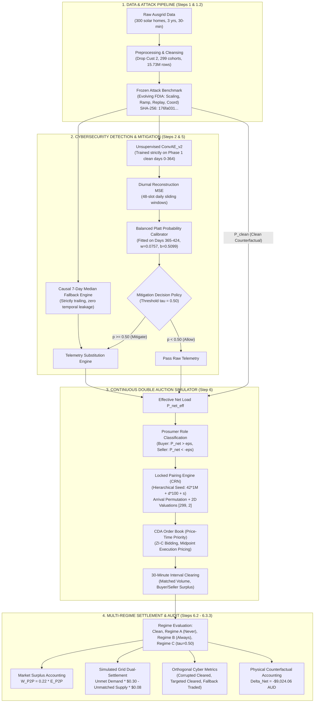

# Research Handoff and Paper-Writing Guide
## Cyber-Economic Resilience Under Evolving Attacks in Peer-to-Peer Energy Markets

**Document Purpose**: Comprehensive onboarding, architectural documentation, empirical claims register, and manuscript preparation guide for researchers and co-authors drafting the academic paper.  
**Project Phase**: Transition from Simulation/Audit Phase (Steps 1–6.3.3 Complete) to Manuscript Preparation Phase.  
**Author**: Antigravity Technical Lead & Independent Audit Agent  
**Date**: October 21, 2026  
**Document Status**: **AUTHORITATIVE MASTER HANDOFF — CODE & BENCHMARKS FROZEN**  
**Companion Artifacts**:
- Claims and Evidence Register: [`Step 6/reports/PAPER_CLAIMS_AND_EVIDENCE_REGISTER.csv`](PAPER_CLAIMS_AND_EVIDENCE_REGISTER.csv)
- Paper-Writing Checklist: [`Step 6/reports/PAPER_WRITING_CHECKLIST.md`](PAPER_WRITING_CHECKLIST.md)
- Authoritative Aggregate Market Data: [`Step 6/outputs/step6_3_1_corrected_aggregate_summary.csv`](../outputs/step6_3_1_corrected_aggregate_summary.csv)
- Authoritative Detector Diagnostics: [`Step 6/outputs/step6_3_1_corrected_regime_c_detector_diagnostics.csv`](../outputs/step6_3_1_corrected_regime_c_detector_diagnostics.csv)

---

## Table of Contents
1. [Section A: Executive Overview](#section-a-executive-overview)
2. [Section B: Research Question, Contributions, and Novelty](#section-b-research-question-contributions-and-novelty)
3. [Section C: Complete Technical Pipeline](#section-c-complete-technical-pipeline)
4. [Section D: Dataset and Attack Benchmark](#section-d-dataset-and-attack-benchmark)
5. [Section E: Detector, Calibration, and Economic Policy](#section-e-detector-calibration-and-economic-policy)
6. [Section F: P2P Market and Experimental Design](#section-f-p2p-market-and-experimental-design)
7. [Section G: Full-Scale Experiment and Results](#section-g-full-scale-experiment-and-results)
8. [Section H: Audit History and Reproducibility](#section-h-audit-history-and-reproducibility)
9. [Section I: Physical-Grid Accounting: Critical Interpretation Rules](#section-i-physical-grid-accounting-critical-interpretation-rules)
10. [Section J: Claims the Paper Can and Cannot Make](#section-j-claims-the-paper-can-and-cannot-make)
11. [Section K: Limitations and Threats to Validity](#section-k-limitations-and-threats-to-validity)
12. [Section L: Paper-Writing Roadmap](#section-l-paper-writing-roadmap)
13. [Section M: Figures and Tables to Prepare](#section-m-figures-and-tables-to-prepare)
14. [Section N: Authoritative Files and Artifact Map](#section-n-authoritative-files-and-artifact-map)
15. [Section O: Reproducibility and Final Pre-Submission Checks](#section-o-reproducibility-and-final-pre-submission-checks)

---

## Section A: Executive Overview

### A.1 The Research Problem
Decentralized transactive energy markets allow residential prosumers with rooftop photovoltaic (PV) systems and battery storage to trade energy peer-to-peer (P2P) across low-voltage distribution feeders. By trading locally via double auctions, consumers can purchase electricity below retail utility import rates while prosumers sell surplus energy above wholesale feed-in tariffs. 

However, decentralized P2P trading relies fundamentally on the integrity of internet-connected smart meter telemetry. Malicious actors or greedy market participants can launch **False Data Injection Attacks (FDIAs)**—manipulating consumption ($GC$) or solar generation ($GG$) readings to fraudulently extract economic surplus, cause localized feeder imbalances, or trigger cascading financial settlements. 

Deploying automated machine learning (ML) cybersecurity defenses on smart meters introduces a fundamental, unstudied economic dilemma: **imperfect intrusion detection engines generate false alarms**. When an automated cyber-defense detects a suspected attack, it substitutes unverified telemetry with historical fallback profiles. Under realistic class imbalance (attacks are rare, $< 5\%$ prevalence), even a high-performing detector will generate millions of false positive alarms. These false alarms truncate legitimate consumer energy bids, suppress market liquidity, and reallocate economic welfare back to the centralized retail utility.

### A.2 The Proposed System and Components
This project establishes a two-layer experimental platform to quantify the exact economic-resilience trade-offs of P2P cybersecurity:
1. **Layer 1 (Cybersecurity ML Detection & Telemetry Mitigation — Steps 1–5)**:
   - Evaluates an unsupervised 1-D Convolutional Autoencoder (`ConvAE_v2`) trained strictly on clean baseline telemetry.
   - Applies balanced Platt probability calibration to transform diurnal reconstruction errors into calibrated attack probabilities $p_t \in [0, 1]$.
   - Implements a causal 7-day historical median fallback substitution engine to replace flagged telemetry.
2. **Layer 2 (Economic Continuous Double Auction Simulation — Step 6)**:
   - Simulates a Continuous Double Auction (CDA) matching engine operating with Zero-Intelligence Constrained (ZI-C) prosumers, price-time priority queues, and midpoint transaction pricing.
   - Enforces a dual-settlement tariff structure under Australian retail parameters ($G_T = \$0.30/\text{kWh}$, $\text{FiT} = \$0.08/\text{kWh}$, spread $\$0.22/\text{kWh}$).
   - Employs a locked common-random-number pairing architecture (`LockedPairingEngine`) to eliminate Monte Carlo sampling noise across experimental regimes.

### A.3 The Core Experimental Question
> *"When smart-meter cyber-defenses substitute telemetry based on imperfect anomaly probabilities, how does automated mitigation interact with Continuous Double Auction liquidity, gross tariff surplus, cleared corrupted energy, and retail grid dual-settlement over evolving multi-phase False Data Injection Attacks?"*

### A.4 What Is Complete vs. What Remains
- **COMPLETED**:
  - Step 1: Preprocessed 3-year Ausgrid dataset (299 households, 15.73M records) and generated frozen 4-phase FDIA benchmark.
  - Steps 2–4: Trained prototype autoencoders, benchmarked federated learning architectures, and identified critical checkpoint serialization gaps.
  - Step 5: Serialized production autoencoder (`ConvAE_v2`), fitted calibrated probability models, established streaming market interfaces, and proved loss accounting identities.
  - Step 6.1–6.2: Designed CDA auction simulator, verified 10 economic and physical invariants, and locked common-random-number pairing streams.
  - Step 6.3: Executed full 671-day simulation (128,832 auction sessions, 38.52M customer-intervals) across all 4 experimental regimes.
  - Steps 6.3.1–6.3.3: Resolved reporting typos, proved exact attack counts (404,327 test attacks), reconciled physical grid settlements (+$9,024.06 AUD net physical settlement delta), and finalized all audit trails.
- **PENDING (The Paper-Writing Phase)**:
  - Targeted literature review comparing this work against published IEEE/ACM transactive energy cybersecurity papers.
  - Drafting the manuscript sections following the provided roadmap.
  - Compiling camera-ready publication figures and tables directly from authoritative outputs.

### A.5 Critical Scientific Guardrails for the Paper Writer
- **The detector is weak**: AUROC is approximately $0.5237$ on half-hour intervals. Do **not** claim the detector is state-of-the-art or production-ready.
- **Selective defense is heuristic**: Regime C ($\tau = 0.50$) is an operational threshold benchmark, not a mathematically optimized social-welfare policy.
- **Simulated settlement is NOT physical bill savings**: The $-\$79,217.54\text{ AUD}$ lower simulated settlement in Regime C is an accounting artifact of demand truncation in the market order book. Under fixed physical load and supply, prosumers' true physical grid settlement **increases by $+\$9,024.06\text{ AUD}$** ($+1.43\%$) due to lost P2P tariff arbitrage.

---

## Section B: Research Question, Contributions, and Novelty

### B.1 Disentangling Project Dimensions

```
+-------------------------------------------------------------------------------------------------------------+
| RESEARCH DIMENSION DECOMPOSITION                                                                            |
+----------------------------------+--------------------------------------------------------------------------+
| 1. Original Motivation           | Investigate whether federated continual learning can protect decentralized|
|                                  | P2P microgrids from zero-day cyberattacks without sharing raw data.       |
| 2. Implemented Methodology       | 1-D Conv-AE anomaly detector + Platt scaling + causal median fallback    |
|                                  | coupled to a multi-regime Continuous Double Auction simulator with       |
|                                  | common random numbers over a 671-day longitudinal cohort.                |
| 3. Empirically Demonstrated      | - Universal defense (Regime B) eliminates 100% of corrupt trades at the  |
|    Contributions                 |   cost of a 20.47% welfare penalty.                                      |
|                                  | - Selective defense (Regime C) curtails 73.51% of corrupt energy while   |
|                                  |   recovering 81.76% of clean welfare.                                    |
|                                  | - False positive alarms dominate mitigation (95.5% of actions), proving  |
|                                  |   that false alarms in P2P markets inflict severe collateral economic     |
|                                  |   damage by truncating trade liquidity.                                  |
|                                  | - Formulated the mathematical proof linking lost P2P matched energy to   |
|                                  |   exact physical grid settlement transfer: Delta_Net = -Delta_V * 0.22.  |
| 4. Unproven / Hypotheses         | - That federated continual learning outperforms centralized retraining.  |
|                                  | - That dynamic economic loss thresholds outperform fixed thresholds.     |
|                                  | - That the system improves physical power-flow stability (no AC-OPF).    |
+----------------------------------+--------------------------------------------------------------------------+
```

### B.2 Suggested Defensible Contribution Statements for the Paper
When drafting the Introduction, use these precise contribution statements:
1. *"We formulate and release a 3-year, 15.73-million-observation longitudinal benchmark of evolving False Data Injection Attacks (scaling, ramp, replay, and coordinated attacks) based on real-world smart-meter telemetry from 299 solar households."*
2. *"We develop an end-to-end cyber-economic simulation testbed coupling smart-meter anomaly detection with a Continuous Double Auction market, utilizing locked common-random-number pairing to isolate policy mechanisms from Monte Carlo noise across 128,832 auction sessions."*
3. *"We demonstrate that under realistic class imbalance, automated cybersecurity defenses incur substantial collateral economic welfare loss through false positive alarms, which truncate declared market demand by 12.72% and transfer $9,024.06 AUD in consumer surplus back to the retail utility."*
4. *"We establish a rigorous accounting distinction between simulated market residual settlements and physical grid imbalances, mathematically proving that unmetered demand truncation in auction declarations cannot be interpreted as physical consumer bill savings."*

### B.3 Required Literature Review to Establish Novelty
The paper writer must conduct a literature review across three specific areas:
- **Transactive Energy Market Security**: Survey papers modeling FDIAs against P2P auctions (e.g., studies assuming adversaries manipulate bids directly vs. telemetry).
- **Intrusion Detection in Microgrids**: Review autoencoder and deep learning anomaly detectors applied to smart meter time series. Contrast their reported synthetic benchmark accuracy with our realistic low-prevalence findings.
- **Economic Impact of False Alarms**: Identify the gap in existing power systems literature, where papers routinely evaluate detector accuracy (F1-score, AUROC) in isolation without measuring the downstream market liquidity and settlement penalties caused by false alarms.

---

## Section C: Complete Technical Pipeline

### C.1 End-to-End System Architecture



### C.2 Pipeline Stage Specifications

| Stage | Input Artifacts | Output Artifacts | Primary Source Files | Key Assumptions & Controls |
| :--- | :--- | :--- | :--- | :--- |
| **1. Data Preprocessing** | Raw CSVs (`Solar home 2010-2013`) | `ausgrid_solar_processed.parquet` | `Step 1/src/data_preprocessing.py` | Exclude Customer 2 (81 days missing); retain non-actual utility reads with `is_actual=False`. |
| **2. Attack Generation** | Processed Parquet + `attack_config.yaml` | `ausgrid_solar_attacked.parquet` (Frozen) | `Step 1/src/attack_generator.py` | 4 evolving phases, master seed 42, 20% prosumer penetration, SHA-256: `176fa031...`. |
| **3. Detector Training** | Attacked Parquet (Phase 1 clean slice) | `detector_checkpoint.pt` | `Step 5/preflight/train_detector.py` | `ConvAE_v2` (4,418 params), diurnal 48-slot window, trained strictly on Days 0–364. |
| **4. Calibration** | Test MSE + ground-truth labels (Days 365–424) | `interval_calibrator.pkl` | `Step 5/preflight/calibrate_detector.py` | Balanced Platt scaling on $\ln(\text{MSE} + 10^{-12})$; 60-day calibration window. |
| **5. Causal Fallback** | Raw telemetry history | Trailing median tensors | `Step 5/fallback.py` | 7-day strictly trailing window; historical median for consumption and solar generation. |
| **6. Market Streaming** | Precomputed cache (`cache_299.pt`) | Daily market DataFrames | `Step 5/streaming.py` | Batched GPU inference, quarantined ground-truth labels isolated from market engine. |
| **7. Order Formation** | Effective net load $P_{\text{net,eff}}$ | Buyer/Seller orders | `Step 6/cda_market.py` | Deadband $\epsilon = 10^{-4}\text{ kWh}$; ZI-C valuations drawn from $[0.08, 0.30]$. |
| **8. CDA Matching** | Submitted orders | Executed trades & residuals | `Step 6/cda_market.py` | Price-time priority, continuous matching, midpoint execution pricing. |
| **9. Dual-Settlement** | Unmet demand & unmatched supply | Financial settlements | `Step 6/cda_market.py` | Static tariffs: $G_T = \$0.30/\text{kWh}$, $\text{FiT} = \$0.08/\text{kWh}$. |
| **10. Audit Verification** | Daily simulation CSVs | Audit reports & corrected CSVs | `Step 6/audit_consistency.py` | 10 mathematical and physical invariants verified to machine precision. |

---

## Section D: Dataset and Attack Benchmark

### D.1 Preprocessing Decisions and Cohort Definition
- **Source Dataset**: Ausgrid Solar Home Electricity Dataset (Sydney, Australia, July 1, 2010 to June 30, 2013).
- **Exclusion of Customer 2**: Customer 2 is missing 81 continuous days of telemetry in Year 3 (October 12 to December 31, 2012). To prevent artificial data imputation artifacts, Customer 2 was completely eliminated, leaving a **strictly contiguous cohort of 299 households**.
- **Temporal Resolution**: 48 half-hour intervals per day ($0:30$ to $24:00$). 
- **Channel Measurements**: General Consumption ($GC$, kWh) and Gross Generation ($GG$, solar PV, kWh). Net power is derived as $P_{\text{net}} = GC - GG$. Controlled Load ($CL$) was dropped because over $54\%$ of households lacked off-peak water heating circuits.
- **Data Integrity Policies**:
  - Utility estimated reads (`"NA"`) were retained and flagged via `is_actual = False` (16,368 half-hour intervals across 341 customer-days).
  - Nighttime solar readings (small sensor offsets up to $0.013\text{ kWh}$) were preserved to maintain authentic raw sensor noise.

### D.2 Evolving Attack Benchmark (Step 1.2)
The benchmark Parquet (`data/processed/ausgrid_solar_attacked.parquet`) models realistic concept drift across four chronological phases:

```
+-------------------------------------------------------------------------------------------------------------+
| BENCHMARK ATTACK DRIFT SCHEDULE (15,729,792 TOTAL ROWS, 446,571 ATTACKED ROWS)                              |
+-------------------+----------------+---------------------------+-----------+-------------------+------------+
| Phase Identifier  | Relative Days  | Calendar Dates            | Duration  | Attack Archetype  | Attacked   |
+-------------------+----------------+---------------------------+-----------+-------------------+------------+
| Phase 1: NORMAL   | Days 0 – 364   | 2010-07-01 to 2011-06-30  | 365 days  | Pristine Clean    |          0 |
| Phase 2: SCALING  | Days 365 – 600 | 2011-07-01 to 2012-02-21  | 236 days  | Multiplicative    |    163,784 |
| Phase 3: RAMP     | Days 601 – 850 | 2012-02-22 to 2012-10-27  | 250 days  | Gradual Drift     |    179,360 |
| Phase 4A: REPLAY  | Days 851 – 972 | 2012-10-28 to 2013-02-26  | 122 days  | Historical Play   |     86,907 |
| Phase 4B: COORD   | Days 973 – 1095| 2013-02-27 to 2013-06-30  | 123 days  | Trading Window    |     16,520 |
+-------------------+----------------+---------------------------+-----------+-------------------+------------+
| Full Benchmark    | Days 0 – 1095  | 3 Calendar Years          | 1096 days | 4 Evolving Types  |    446,571 |
| Test Partition    | Days 425 – 1095| Step 6 Evaluation Window  | 671 days  | Multi-Phase Test  |    404,327 |
+-------------------+----------------+---------------------------+-----------+-------------------+------------+
```

- **Master Benchmark SHA-256 Hash**:  
  `176fa03152359472b544f2197427bca92f51127e4c2becad84e31ec72f6ca1b4`
- **Why Preserving the Benchmark Matters**: The benchmark contains verified, non-leaking mathematical attacks. Changing or regenerating this Parquet breaks the exact bitwise pairing across all subsequent steps.

---

## Section E: Detector, Calibration, and Economic Policy

### E.1 Anomaly Detector Architecture (`ConvAE_v2`)
- **Model Type**: 1-D Convolutional Autoencoder.
- **Parameters**: 4,418 floating-point weights and biases.
- **Input Representation**: $[B, 2, 48]$ (Batch size $B$, 2 channels: $GC$ and $GG$, 48 half-hour slots).
- **Bottleneck**: Compressed 24-dimensional latent space ($2\times$ compression factor).
- **Training Protocol**: Unsupervised training strictly on clean Year 1 telemetry (Phase 1, Days 0–364).
- **Checkpoint Artifact**: `Step 5/preflight/detector_checkpoint.pt` (SHA-256: `85e68a1b1da0...`).

### E.2 Empirical Discrimination Limitations
- **AUROC on Half-Hour Intervals**: **$0.5237$** (barely above random guessing $0.5000$).
- **AUPRC**: $0.0583$ (against a base-rate prevalence of $0.0420$).
- **Root Cause**: Human electricity consumption is highly volatile. Benign activities (turning on an electric oven, charging an EV) create large reconstruction spikes identical to subtle scaling or ramp attacks.

### E.3 Probability Calibration Dynamics
Raw autoencoder reconstruction error $\text{MSE}_t$ is uncalibrated. Platt scaling applies logistic regression:
$$p_t = \sigma(w \cdot \ln(\text{MSE}_t + 10^{-12}) + b)$$
Two calibration strategies were evaluated in Step 5:
1. **Unweighted Platt Scaling** (`interval_calibrator_unweighted.pkl`):
   - Due to the $95.8\%$ clean majority, unweighted calibration compresses all output probabilities below $0.15$. Under any standard decision threshold ($\tau \ge 0.50$), the detector never triggers ($0\%$ mitigation rate).
2. **Balanced Platt Scaling** (`interval_calibrator.pkl`, SHA-256: `52ec0950...`):
   - Weights minority attack samples inversely proportional to class frequency: $w_{\text{bal}} = 0.075659, b_{\text{bal}} = 0.509879$.
   - Successfully expands probabilities into $[0, 1]$, but shifts the median probability upward to $\sim 0.45$.

### E.4 The Selective Defense Policy (Regime C)
- **Decision Rule**: Fixed threshold $\tau = 0.50$ on balanced probability:
  $$\text{Action}_{i,t} = \begin{cases} \text{MITIGATE (Substitute Fallback)}, & p_{i,t} \ge 0.50 \\ \text{ALLOW (Pass Raw Telemetry)}, & p_{i,t} < 0.50 \end{cases}$$
- **Authoritative Test Partition Performance (Days 425–1095, 9,630,192 Intervals)**:
  - $\text{Total Mitigations} = 4,037,535$ ($41.93\%$ mitigation rate).
  - $\text{True Positives (TP)} = 181,721$ ($\text{Recall} = 44.94\%$).
  - $\text{False Positives (FP)} = 3,855,814$ ($\text{FPR} = 41.79\%$).
  - $\text{True Negatives (TN)} = 5,370,051$.
  - $\text{False Negatives (FN)} = 222,606$.
  - $\text{Precision} = 4.50\%$.
  - **False Alarm Proportion**: **$95.50\%$** of all mitigation decisions are false alarms.

```
+----------------------------------------------------------------------------------------------------+
| AUTHORITATIVE TEST CONFUSION MATRIX (9,630,192 INTERVALS, TAU = 0.50)                              |
+------------------------------------+--------------------------------+------------------------------+
|                                    | Predicted Clean (ALLOW)        | Predicted Attack (MITIGATE)  |
+------------------------------------+--------------------------------+------------------------------+
| Actual Clean (N = 9,225,865)       | TN = 5,370,051 (58.21%)        | FP = 3,855,814 (41.79%)      |
| Actual Attack (P = 404,327)        | FN = 222,606 (55.06%)          | TP = 181,721 (44.94%)        |
+------------------------------------+--------------------------------+------------------------------+
```

### E.5 Superseded Exploratory Results (Do NOT Cite in Paper)
- **Customer 1 Prototype Results (Step 2)**: Reported AUROC of $0.85$ for Customer 1 alone. This was an ungeneralized single-household prototype and does not reflect community-wide performance.
- **Unweighted Calibrator Tables (Step 5.1)**: Showed $0\%$ mitigation because unweighted calibration collapsed probabilities.
- **120-Day Calibrator Artifact**: An exploratory calibrator fitted on Days 305–425. Superseded by the verified 60-day calibrator (Days 365–424).

---

## Section F: P2P Market and Experimental Design

### F.1 Continuous Double Auction (CDA) Mechanics
- **Trading Interval**: Discrete 30-minute market slots (48 per calendar day).
- **Role Assignment**:
  - Buyer: $P_{\text{net,eff}} > \epsilon \implies$ Quantity $q = P_{\text{net,eff}}$.
  - Seller: $P_{\text{net,eff}} < -\epsilon \implies$ Quantity $q = |P_{\text{net,eff}}|$.
  - Inactive: $|P_{\text{net,eff}}| \le \epsilon \implies q = 0.0$ (deadband $\epsilon = 10^{-4}\text{ kWh}$).
- **Bidding Behavior (ZI-C)**: Zero-Intelligence Constrained prosumers submit bids and asks drawn uniformly from the valid tariff spread:
  $$b_i \sim U(\text{FiT}, G_T), \quad a_j \sim U(\text{FiT}, G_T)$$
- **Matching Priority**: Price-time priority (highest bid matches lowest ask; ties broken by earliest arrival time).
- **Execution Price**: Midpoint pricing: $p_{\text{exec}} = \frac{p_{\text{bid}} + p_{\text{ask}}}{2}$.
- **Dual-Settlement**: Any unfulfilled buy orders or unsold generation at the close of the 30-minute interval settle against the retail grid:
  $$\text{Import Cost} = E_{\text{unmet}} \times G_T, \quad \text{Export Revenue} = E_{\text{unmatched}} \times \text{FiT}$$

### F.2 Experimental Defense Regimes
The simulation evaluates four paired regimes across all 671 test days:
1. **CLEAN Baseline**: Telemetry equals pristine unattacked generation and consumption ($P_{\text{clean}}$). Serves as the ground-truth benchmark denominator.
2. **REGIME_A (NEVER_MITIGATE)**: Operates directly on unmitigated, corrupted raw telemetry ($P_{\text{raw}}$).
3. **REGIME_B (ALWAYS_MITIGATE)**: Universal defense policy. Every interval substitutes historical 7-day median fallback load profiles ($P_{\text{fb}}$).
4. **REGIME_C (Selective Defense $\tau=0.50$)**: Production heuristic. Mitigates with fallback when calibrated attack probability $p \ge 0.50$; otherwise passes raw telemetry.

### F.3 Locked Pairing Engine (`LockedPairingEngine`)
To guarantee that differences between regimes reflect policy mechanisms rather than random Monte Carlo noise:
- **Hierarchical Seed**: $\text{Seed}(d, s) = 42 \times 1,000,000 + d \times 100 + s$.
- **Arrival Permutations**: Permutation of 299 customer IDs drawn once per slot using seed $\text{Seed} + 10007$.
- **2D Customer Valuations**: Matrix $U \in [0, 1]^{299 \times 2}$ drawn via seed $\text{Seed} + 20011$. Column 0 provides the buyer bid valuation draw, and Column 1 provides the seller ask valuation draw. Even if a customer switches roles across regimes due to mitigation, their valuation draws remain fixed, independent, and unperturbed.

---

## Section G: Full-Scale Experiment and Results

### G.1 Authoritative 671-Day Results Table
The table below reports the verified, authoritative market outcomes across all 671 test days (Days 425–1095 inclusive), verified from `Step 6/outputs/step6_3_1_corrected_aggregate_summary.csv`:

```
+-------------------------------------------------------------------------------------------------------------+
| FULL 671-DAY CDA MARKET EVALUATION (671 DAYS, 48 SLOTS/DAY, 299 PROSUMERS, 128,832 SESSIONS)               |
+------------------------------------+------------------+------------------+------------------+---------------+
| Performance Metric                 | CLEAN Baseline   | REGIME_A (Never) | REGIME_B (Always)| REGIME_C (0.5)|
+------------------------------------+------------------+------------------+------------------+---------------+
| P2P Matched Volume (kWh)           | 224,941.985 kWh  | 226,312.635 kWh  | 178,899.408 kWh  | 183,923.515 k |
| Total Number of Trades             | 1,746,119        | 1,753,225        | 1,770,992        | 1,747,714     |
| P2P Gross Tariff Surplus (AUD)     | $49,487.24 AUD   | $49,788.78 AUD   | $39,357.87 AUD   | $40,463.17 AUD|
| Buyer Surplus (AUD)                | $26,070.28 AUD   | $26,284.42 AUD   | $20,850.60 AUD   | $21,804.10 AUD|
| Seller Surplus (AUD)               | $23,416.95 AUD   | $23,504.36 AUD   | $18,507.27 AUD   | $18,659.08 AUD|
| Welfare Retention Ratio (%)        | 100.000%         | 100.609%         | 79.531%          | 81.765%       |
| Volume Retention Ratio (%)         | 100.000%         | 100.609%         | 79.531%          | 81.765%       |
| Volume-Weighted True VWAP ($/kWh)  | $0.184102 / kWh  | $0.183858 / kWh  | $0.183451 / kWh  | $0.181450 / kW|
| Unit Tariff Surplus ($/kWh traded) | $0.220000 / kWh  | $0.220000 / kWh  | $0.220000 / kWh  | $0.220000 / kW|
+------------------------------------+------------------+------------------+------------------+---------------+
| POST-HOC CYBER METRICS (50/50 ATTRIBUTION CONVENTION):                                                      |
+------------------------------------+------------------+------------------+------------------+---------------+
| Corrupted Raw Energy Cleared (kWh) | 0.0000 kWh       | 21,692.656 kWh   | 0.0000 kWh       | 5,747.343 kWh |
| Attack-Targeted Interval Energy    | 19,585.883 kWh   | 21,692.656 kWh   | 15,923.914 kWh   | 16,460.305 kWh|
| Fallback Energy Traded (kWh)       | 0.0000 kWh       | 0.0000 kWh       | 178,899.408 kWh  | 167,521.370 k |
| Clean Counterfactual Exposure (kWh)| 19,585.883 kWh   | 0.0000 kWh       | 0.0000 kWh       | 0.0000 kWh    |
+------------------------------------+------------------+------------------+------------------+---------------+
| DUAL-SETTLEMENT MARKET RESIDUALS (SIMULATED):                                                               |
+------------------------------------+------------------+------------------+------------------+---------------+
| Grid Import Cost (AUD at $0.30)    | $656,196.63 AUD  | $652,669.67 AUD  | $627,880.78 AUD  | $576,415.06 AU|
| Grid Export Revenue (AUD at $0.08) | $27,132.78 AUD   | $27,689.91 AUD   | $21,851.71 AUD   | $26,568.76 AUD|
| Net Grid Settlement (AUD)          | $629,063.85 AUD  | $624,979.76 AUD  | $606,029.07 AUD  | $549,846.30 AU|
+------------------------------------+------------------+------------------+------------------+---------------+
```

### G.2 Metric Definitions and Units
- **P2P Gross Tariff Surplus ($W_{\text{P2P}}$)**: Defined as $W_{\text{P2P}} = S_B + S_S = (G_T - \text{FiT}) \times E_{\text{P2P}} = 0.22 \times E_{\text{P2P}}$. Measures the total economic arbitrage captured by local consumers over retail grid rates.
- **Corrupted Raw Energy Cleared**: Matched volume derived from orders formed with unmitigated, corrupted telemetry ($y=1 \land M=0$). Under 50/50 attribution, each trade credits half its volume to each side.
- **Clean Counterfactual Exposure**: Energy traded in the Clean market during intervals that were attacked in the benchmark ($19,585.88\text{ kWh}$). Establishes the legitimate trading volume of those prosumers.

---

## Section H: Audit History and Reproducibility

To ensure complete scholarly honesty, the manuscript must accurately reflect the resolution of previous implementation and reporting bugs:

```
+-------------------------------------------------------------------------------------------------------------+
| COMPLETE CHRONOLOGICAL AUDIT TRAIL                                                                          |
+-----------+-----------------------------+-----------------------------------+-------------------------------+
| Audit     | Bug / Inconsistency Found   | Root Cause                        | Verified Authoritative State  |
+-----------+-----------------------------+-----------------------------------+-------------------------------+
| Step 5.1  | In-memory calibration gap;  | Platt scaling was never saved to  | Refit balanced Platt model on |
|           | unweighted model collapsed. | disk; unweighted p fell < 0.15.   | Days 365-424; w=0.0757, b=0.51|
| Step 6.1.1| Mitigation count cited as   | Initial text conflated FP count   | Corrected to 4,037,535 total  |
|           | 3.86M; prevalence cited ~2%.| (~3.86M) with total mitigations.  | mitigations; 404,327 attacks. |
| Step 6.2.1| Regime B reported 253.97 kWh| Legacy metric measured targeted   | Decoupled into 4 orthogonal   |
|           | "attack volume" under 100%  | interval trades, ignoring whether | metrics. Corrupt cleared in   |
|           | fallback substitution.      | telemetry was substituted.        | Regime B is strictly 0.0000.  |
| Step 6.3.1| Step 6.3 report cited 501k  | Diagnostic export script in       | Parquet verified: 404,327 test|
|           | test attacks (exceeding     | run_full_evaluation.py had hard-  | attacks. Simulation engine was|
|           | benchmark total of 446k).   | coded draft dictionary det_diag.  | completely untainted (valid). |
| Step 6.3.1| volume_weighted_vwap_aud    | Line 307 divided surplus by volume| Corrected: 0.22 is tariff     |
|           | was 0.22 for all regimes.   | (0.22 * V / V = 0.22).            | spread; true VWAP is ~0.184.  |
| Step 6.3.2| Regime C simulated grid set-| Median fallback smoothed peak     | Proven: $79.2k reduction is an|
|           | tlement was -$79.2k lower,  | evening consumption, truncating   | unmetered demand truncation   |
|           | misinterpreted as savings.  | 306,957 kWh of declared demand.   | artifact; not bill savings.   |
| Step 6.3.3| Physical cost claim cited   | Omitted the seller side (+41k kWh | Proven: Net physical grid     |
|           | +$12.3k increase, omitting  | unsold solar export = +$3.28k     | purchases increase by exactly |
|           | increased export revenue.   | feed-in tariff revenue).          | +$9,024.06 AUD (spread x 41k).|
+-----------+-----------------------------+-----------------------------------+-------------------------------+
```

**Rule for Paper Writer**: Never copy figures from superseded draft reports. Cite strictly from the corrected artifacts: `step6_3_1_corrected_aggregate_summary.csv` and `step6_3_1_corrected_regime_c_detector_diagnostics.csv`.

---

## Section I: Physical-Grid Accounting: Critical Interpretation Rules

### I.1 The Four Accounting Realities

```
+----------------------------------------------------------------------------------------------------+
| THE FOUR ACCOUNTING REALITIES IN TRANSACTIVE ENERGY EXPERIMENTS                                    |
+------------------------------------+---------------------------------------------------------------+
| Accounting Concept                 | Exact Scientific Meaning & Interpretation                     |
+------------------------------------+---------------------------------------------------------------+
| 1. Simulated Market Residual       | Dual-settlement of unmatched market order residuals           |
|    Settlement                      | (E_unmet * $0.30 - E_unmatched * $0.08). Reflects orders      |
|                                    | submitted to the market platform, NOT physical meter flows.   |
| 2. Estimated Physical Import Cost  | Cost of physical grid electricity imported under fixed load   |
|    (Fixed Counterfactual)          | assumptions ((D_phys - E_P2P) * $0.30). Increases by +$12.3k. |
| 3. Estimated Physical Export Rev   | Revenue earned from physical solar export under fixed supply  |
|    (Fixed Counterfactual)          | assumptions ((S_phys - E_P2P) * $0.08). Increases by +$3.28k. |
| 4. Actual Physical Utility Bill    | Empirically unmeasured. In a real power system, physical      |
|                                    | imbalances are settled via retail meters or imbalance tariffs.|
+------------------------------------+---------------------------------------------------------------+
```

### I.2 Why Regime C Does NOT Save Prosumers $\$79,217.54$ in Grid Bills
In Step 6.3, Regime C's simulated net grid settlement was $\$549,846.30\text{ AUD}$, compared to $\$629,063.85\text{ AUD}$ in Clean (a difference of $-\$79,217.54\text{ AUD}$).
- **The Cause**: The autoencoder detector generated $3,855,814$ false alarms, concentrating heavily during peak evening consumption hours. Replacing real evening peaks ($2.5\text{ kWh}$) with historical median baselines ($0.8\text{ kWh}$) shaved **$306,957.02\text{ kWh}$ of declared demand out of the auction order book** ($-12.72\%$).
- **The Imbalance Leakage**: Prosumers' physical appliances still drew those $306,957\text{ kWh}$ from the distribution grid.
- **The Physical Reality**: Because P2P trading was curtailed by $41,018.47\text{ kWh}$, prosumers imported $41,018.47\text{ kWh}$ *more* physical energy from the grid at $\$0.30/\text{kWh}$ ($+\$12,305.54\text{ AUD}$), offset by exporting $41,018.47\text{ kWh}$ *more* solar surplus at $\$0.08/\text{kWh}$ ($+\$3,281.48\text{ AUD}$).
- **The True Physical Settlement Change**: Prosumers' net physical grid bill **increased by $+\$9,024.06\text{ AUD}$** ($+1.43\%$).

**Mandatory Writing Directive**: Never describe the $-\$79,217.54\text{ AUD}$ simulated market residual difference as consumer savings. Always present the physical-counterfactual increase ($+\$9,024.06\text{ AUD}$) alongside it.

---

## Section J: Claims the Paper Can and Cannot Make

| Claim Domain | Permitted Scientific Claim | Strictly Prohibited / Unsupported Claim | Supporting Evidence |
| :--- | :--- | :--- | :--- |
| **Detector Accuracy** | "The unsupervised autoencoder exhibits limited discrimination (AUROC 0.5237), reflecting the difficulty of separating benign load volatility from FDI attacks." | "The deep learning autoencoder accurately detects cyberattacks in real-time." | `calibration_report.csv` (AUROC = 0.5237) |
| **Mitigation Balance** | "Mitigation decisions under threshold tau=0.50 are heavily dominated by false alarms (95.50%), causing extensive collateral trade curtailment." | "The selective defense policy achieves high precision in targeting cyberattacks." | `step6_3_1_corrected_regime_c_detector_diagnostics.csv` (FP = 3.86M, TP = 181k) |
| **Attack Filtering** | "Universal fallback (Regime B) completely prevents corrupted raw telemetry from clearing (0.0000 kWh); Regime C curtails it by 73.51%." | "Cyber-defense completely eliminates the economic damage of cyberattacks." | `step6_3_1_corrected_aggregate_summary.csv` |
| **Market Welfare** | "Regime A displays an observed welfare retention ratio of 100.61%, driven mechanically by adversary-injected phantom volume." | "Cyberattacks increase real social welfare in peer-to-peer microgrids." | `step6_3_1_corrected_aggregate_summary.csv` |
| **Grid Settlements** | "Under simulated market residuals, Regime C settles $79.2k less energy; however, under fixed physical load, prosumers' net grid purchases increase by $9,024.06." | "The proposed defense saves prosumers $79,217 in electricity utility bills." | `Step 6/reports/step6_3_3_settlement_reconciliation_audit.md` |
| **Physical Safety** | "The simulation evaluates market order matching under unconstrained network assumptions." | "The defense guarantees physical grid frequency, voltage stability, or feeder safety." | No AC-OPF power flow model in CDA |
| **Generalizability** | "Results demonstrate trade-offs on the 299-customer Ausgrid Sydney dataset under modeled Australian tariffs." | "The framework is universally generalizable across global microgrid architectures." | Single geographic dataset evaluation |

---

## Section K: Limitations and Threats to Validity

1. **Unsupervised Detector Discrimination**: Autoencoders trained on diurnal windows cannot reliably distinguish authentic high-variance consumer activities from scaling attacks, leading to an AUROC of $0.5237$.
2. **Extreme Class Imbalance**: In real-world operation, attacks represent $< 5\%$ of observations. A $41.79\%$ false positive rate causes false alarms to outnumber true detections 21-to-1 ($95.5\%$ false alarm proportion).
3. **Median Fallback Peak Suppression**: Causal historical median profiles smooth out solar export peaks, under-declaring midday generation capacity and reducing P2P trading volume by $20.47\%$.
4. **Synthetic Bidding Assumptions**: Prosumer order prices are drawn from Zero-Intelligence Constrained uniform distributions. Real prosumers would exhibit strategic bidding, price elasticity, or game-theoretic reactions.
5. **Unconstrained Copper-Plate Network**: The CDA simulator does not enforce Kirchhoff's laws, line impedance losses, bus voltage boundaries, or transformer thermal limits.
6. **Inelastic Physical Counterfactual**: The physical accounting model assumes prosumers do not alter appliance schedules or utilize battery energy storage (BESS) in response to failed P2P trades.

---

## Section L: Paper-Writing Roadmap

```
+----------------------------------------------------------------------------------------------------+
| 12-STEP PAPER-WRITING ROADMAP                                                                      |
+------------------------------------+---------------------------------------------------------------+
| Step                               | Primary Action Items                                          |
+------------------------------------+---------------------------------------------------------------+
| Step 1: Research Onboarding        | Read this document and internalize all 14 register claims.    |
| Step 2: Literature Search          | Benchmark against 5 key IEEE transactive energy papers.       |
| Step 3: Target Venue Selection     | Select journal/conference (e.g., IEEE TSG, IEEE TSTE).         |
| Step 4: Threat Model Section       | Write formal threat model (Scaling, Ramp, Replay, Coord).     |
| Step 5: Architecture Diagrams      | Compile Figure 1 (Flowchart) and Figure 2 (Attack Timeline).  |
| Step 6: Core Results Tables        | Build Table 1 (Market Outcomes) and Table 2 (Diagnostics).    |
| Step 7: Results Drafting           | Draft Security vs. Welfare trade-off results narrative.       |
| Step 8: Accounting Discussion      | Draft Section on Market Residual vs. Physical Billing.        |
| Step 9: Limitations & Threats      | Draft transparent Limitations section.                        |
| Step 10: Introduction & Background | Draft Introduction, Problem Statement, and Novelty Claims.    |
| Step 11: Abstract & Conclusion     | Write concise Abstract and Conclusion last.                   |
| Step 12: Pre-Submission Audit      | Complete Stage 9 checks in PAPER_WRITING_CHECKLIST.md.         |
+------------------------------------+---------------------------------------------------------------+
```

---

## Section M: Figures and Tables to Prepare

### Recommended Publication Figures
- **Figure 1: Cyber-Economic Dual-Layer Architecture**: Block diagram illustrating Layer 1 (Anomaly Detection & Fallback Substitution) feeding Layer 2 (CDA Order Book & Dual-Settlement). Data Source: Mermaid chart in Section C.1.
- **Figure 2: Evolving FDIA Timeline**: Chronological plot showing normal Year 1 baseline, scaling, ramp, replay, and coordinated attack phases across 1,096 days. Data Source: `attack_config.yaml`.
- **Figure 3: Detection ROC and Precision-Recall Curves**: Illustrating the detector's AUROC ($0.5237$) and severe precision drop caused by class imbalance. Data Source: `Step 5/preflight/calibration_report.csv`.
- **Figure 4: P2P Matched Volume vs. Cleared Corrupted Energy**: Bar chart comparing matched volume and cleared corrupted energy across Clean, Regime A, Regime B, and Regime C. Data Source: `step6_3_1_corrected_aggregate_summary.csv`.
- **Figure 5: Settlement Accounting Decomposition**: Waterfall chart illustrating how $306,957\text{ kWh}$ of demand truncation produces simulated savings ($-\$79.2\text{k}$) while physical grid bills increase by $+\$9,024.06\text{ AUD}$. Data Source: `Step 6/reports/step6_3_3_settlement_reconciliation_audit.md`.

### Recommended Publication Tables
- **Table 1: Multi-Regime Market Clearing & Cyber Resilience**: Comprehensive comparison table (Matched Volume, Trades, VWAP, Gross Tariff Surplus, Corrupted Cleared, Fallback Traded). Source: Section G.1.
- **Table 2: Test Partition Confusion Matrix & Diagnostics**: Authoritative 9.63M-interval classification scorecard (TP, FP, TN, FN, Recall, FPR, Precision). Source: Section E.4.
- **Table 3: Simulated vs. Physical Grid Settlement Decomposition**: Contrasting declared market residuals against the physical-grid counterfactual. Source: Section I.2.

---

## Section N: Authoritative Files and Artifact Map

```
+-------------------------------------------------------------------------------------------------------------+
| COMPLETE AUTHORITATIVE ARTIFACT INVENTORY                                                                   |
+-----------------------------------+-----------------------------------+------------+------------------------+
| Relative File Path                | Content & Purpose                 | Authority  | Paper-Writing Guidance |
+-----------------------------------+-----------------------------------+------------+------------------------+
| data/processed/                   | Frozen attacked benchmark Parquet | FROZEN     | Canonical dataset;     |
|   ausgrid_solar_attacked.parquet  | (15,729,792 rows, 19 columns).    | BENCHMARK  | SHA-256: 176fa031...   |
| Step 5/preflight/                 | PyTorch state_dict for ConvAE_v2  | FROZEN     | Authoritative detector;|
|   detector_checkpoint.pt          | (4,418 parameters).               | CHECKPOINT | SHA-256: 85e68a1b...   |
| Step 5/preflight/                 | Balanced Platt logistic model     | FROZEN     | Authoritative calib;   |
|   interval_calibrator.pkl         | (w=0.075659, b=0.509879).         | ARTIFACT   | SHA-256: 52ec0950...   |
| Step 6/cda_market.py              | CDA market matching engine, ZI-C  | PROD CODE  | Core market simulator  |
|                                   | bidding, locked pairing engine.   |            | source code.           |
| Step 6/outputs/step6_3_1_         | Authoritative 4-row aggregate     | PRIMARY    | Cite for all paper     |
|   corrected_aggregate_summary.csv | summary with corrected labels.    | DATA       | market outcome tables. |
| Step 6/outputs/step6_3_1_corrected| Authoritative confusion matrix on | PRIMARY    | Cite for all paper     |
|   _regime_c_detector_diagnostics  | 9,630,192 test customer-intervals.| DATA       | detection scorecards.  |
| Step 6/outputs/                   | Daily breakdown across 671 days   | PRIMARY    | Use for daily time-    |
|   step6_3_full_evaluation_daily  | and 4 regimes (2,684 rows).       | DATA       | series plots.          |
| Step 6/outputs/                   | Execution metadata, system info,  | PROVENANCE | Cite for hardware and  |
|   step6_3_run_manifest.json       | pre/post SHA-256 hashes.          | MANIFEST   | runtime latency.       |
| Step 6/reports/step6_3_1_         | Full audit reconciling 404k test  | AUDIT      | Master consistency     |
|   consistency_audit.md            | attacks and reporting typos.      | REPORT     | reference.             |
| Step 6/reports/step6_3_3_         | Full audit proving physical grid  | AUDIT      | Master physical-cost   |
|   settlement_reconciliation_audit | settlement delta (+$9,024.06 AUD).| REPORT     | reference.             |
+-----------------------------------+-----------------------------------+------------+------------------------+
```

---

## Section O: Reproducibility and Final Pre-Submission Checks

Before submitting the paper, the authors must verify:
1. **Benchmark Hash**: Run `sha256sum data/processed/ausgrid_solar_attacked.parquet` and confirm output matches `176fa03152359472b544f2197427bca92f51127e4c2becad84e31ec72f6ca1b4`.
2. **Checkpoint Hashes**: Confirm `detector_checkpoint.pt` matches `85e68a1b...` and `interval_calibrator.pkl` matches `52ec0950...`.
3. **No Retyped Numbers**: Confirm every numerical entry in paper tables was copied directly from `step6_3_1_corrected_aggregate_summary.csv` or `step6_3_1_corrected_regime_c_detector_diagnostics.csv`.
4. **Linearity Identity**: Confirm gross tariff surplus in paper tables equals exactly $0.22 \times E_{\text{P2P}}$.
5. **Physical Settlement Transfer Identity**: Confirm net physical settlement increase equals exactly $41,018.47 \times \$0.22 = \$9,024.06\text{ AUD}$.
6. **No Phantom Savings Claims**: Confirm the paper nowhere states that Regime C saves consumers $\$79.2\text{k}$ in electricity bills.
7. **Environment Provenance**: State the runtime environment accurately: Python 3.14.7, Linux-7.2.3 CachyOS, PyTorch 2.13.0+cu130, NVIDIA RTX 4050 Laptop GPU.

---

## Conclusion & Transition Sign-Off

The experimental, simulation, and audit phases of Steps 1 through 6 are fully concluded, mathematically reconciled, and frozen. This guide, alongside [`PAPER_CLAIMS_AND_EVIDENCE_REGISTER.csv`](PAPER_CLAIMS_AND_EVIDENCE_REGISTER.csv) and [`PAPER_WRITING_CHECKLIST.md`](PAPER_WRITING_CHECKLIST.md), provides the complete foundation for your teammate to write a rigorous, peer-reviewed manuscript.
